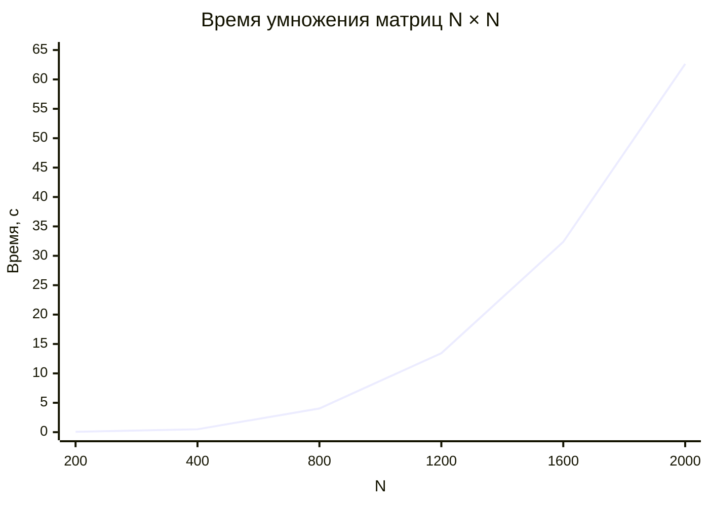

# Лабораторная работа №1: Последовательный алгоритм умножения матриц

## Цель работы

Получить данные о производительности последовательного алгоритма умножения
квадратных матриц для последующего сравнения с параллельными реализациями.

## Задачи

* Написать программу для создания исходных матриц и записи их в файл
* Написать программу на языке C++ для перемножения двух квадратных матриц
* Написать скрипт для проверки вычислений на Python
* Сделать отчёт о проделанной работе

## Ход работы

### Создание исходных файлов

Генерация случайных матриц вынесена в отдельный модуль `RMatrix`. Функция
принимает количество элементов и возвращает готовый вектор целых чисел
в диапазоне от 0 до 100.

```cpp
export module RMatrix;

import std;

export std::vector<int> generateRandomMatrix(std::size_t count, int min = 0, int max = 100) {
    std::random_device rd;
    std::mt19937 gen(rd());
    std::uniform_int_distribution<int> dist(min, max);

    std::vector<int> matrix(count);
    for (auto& x : matrix) x = dist(gen);
    return matrix;
}
```

Сохранение вектора в файл выполняет модуль `IOMatrix` — одно число на строку.
Такой формат одинаково хорошо читается и в C++ через `operator>>`, и в
NumPy через `np.loadtxt`.

```cpp
export void VectorSaving(const std::vector<int>& vec, const std::string& path) {
    std::ofstream file(path);
    if (!file) throw std::logic_error("Error open file");

    for (int x : vec) std::println(file, "{}", x);
}
```

### Основная программа на C++

Программа собрана из четырёх модулей:

| Модуль | Ответственность |
| --- | --- |
| `IOMatrix` | чтение, запись, вывод результата |
| `Multiplyer` | само умножение матриц |
| `RMatrix` | генерация случайных матриц |
| `main` | точка входа, ввод размера, выбор ветки load/generate |

Загрузка матрицы из файла возвращает `bool` вместо исключения — решение о
дальнейших действиях принимает `main`.

```cpp
export bool VectorLoading(std::vector<int>& vec, const std::string& path) {
    std::ifstream file(path);
    if (!file.is_open()) return false;

    int number;
    while (file >> number) vec.push_back(number);
    return true;
}
```

Поскольку `std::vector` одномерен, а матрица хранится построчно, используется
формула умножения в одномерном представлении. Внешние два цикла идут по `i`
и `k`, во внутреннем считается сразу вся строка результата.

```cpp
export void MultiplyerMatrix(const std::vector<int>& a, const std::vector<int>& b,
                             std::vector<long long>& result, std::size_t size) {
    result.assign(size * size, 0);

    for (std::size_t i = 0; i < size; ++i)
        for (std::size_t k = 0; k < size; ++k) {
            long long a_ik = a[i * size + k];
            for (std::size_t j = 0; j < size; ++j)
                result[i * size + j] += a_ik * b[k * size + j];
        }
}
```

Запись результата сопровождается шапкой с метаданными. Символ `#` в начале
строки — маркер комментария: NumPy пропускает такие строки автоматически
через `comments='#'`, поэтому файл остаётся и читаемым глазами, и парсится
без хаков.

```cpp
export void WriteResult(const std::vector<long long>& result, std::string_view filename,
                        std::size_t size, const auto& time) {
    std::ofstream file(std::format("../../../lab1/data/result/{}", filename));
    if (!file) throw std::logic_error("Error open file");

    std::println(file, "#Execution time: {}", time);
    std::println(file, "#Number of matrix elements: {}\n", size * size);

    for (std::size_t i = 0; i < size; ++i) {
        for (std::size_t j = 0; j < size; ++j)
            std::print(file, "{:12}", result[i * size + j]);
        std::println(file, "");
    }
    std::println("Matrix successfully written to file {}", filename);
}
```

Точка входа. Сначала спрашиваем размер, потом пытаемся загрузить обе матрицы.
Если хотя бы одна не открылась — генерируем обе заново и сохраняем, чтобы
при следующем запуске они уже читались с диска.

```cpp
int main() {
    constexpr std::array sizes = {200, 400, 800, 1200, 1600, 2000};
    std::println("Choose matrix size: 200, 400, 800, 1200, 1600 or 2000");

    int size = 0;
    while (!std::ranges::contains(sizes, size)) {
        std::cin >> size;
        if (!std::ranges::contains(sizes, size))
            std::println("Enter a valid matrix size from the list");
    }

    auto dataPath = [](int n, int idx) {
        return std::format("../../../lab1/data/m{}_{}.txt", n, idx);
    };

    std::vector<int> a, b;
    std::vector<long long> c;

    bool loaded = VectorLoading(a, dataPath(size, 1))
               && VectorLoading(b, dataPath(size, 2));

    if (!loaded) {
        std::println("Files not found - generating random matrices");
        a = generateRandomMatrix(size * size);
        b = generateRandomMatrix(size * size);
        VectorSaving(a, dataPath(size, 1));
        VectorSaving(b, dataPath(size, 2));
    } else {
        std::println("Matrices loaded from files");
    }

    auto start = std::chrono::steady_clock::now();
    MultiplyerMatrix(a, b, c, size);
    auto end = std::chrono::steady_clock::now();

    WriteResult(c, std::format("result{}.txt", size), size, end - start);
}
```

### Проверка результата на Python

Для подтверждения правильности работы алгоритма использована
автоматизированная верификация на Python с библиотекой NumPy. Скрипт читает
обе исходные матрицы и результат, считает эталонное произведение `A @ B` и
сравнивает с тем, что записала C++ программа.

Пути строятся от расположения самого скрипта через `Path(__file__)`, поэтому
его можно запускать из любой директории.

```python
from pathlib import Path
import numpy as np

base = Path(__file__).resolve().parent.parent / "data"

sizes = [200, 400, 800, 1200, 1600, 2000]

for n in sizes:
    try:
        a = np.loadtxt(base / f"m{n}_1.txt", dtype=np.int64).reshape(n, n)
        b = np.loadtxt(base / f"m{n}_2.txt", dtype=np.int64).reshape(n, n)
        c = np.loadtxt(base / "result" / f"result{n}.txt", dtype=np.int64, comments='#')

        print(f"[{n}x{n}] {'OK' if np.array_equal(a @ b, c) else 'FAIL'}")
    except FileNotFoundError as e:
        print(f"[{n}x{n}] skip ({e.filename})")
```

### Результаты измерений производительности

Эксперимент проводился на последовательной реализации алгоритма умножения
матриц. Для каждого размера матрицы `N × N` было проведено 5 замеров
времени выполнения. Результаты представлены в таблице 1.

| Размер матрицы | Измерение #1 | Измерение #2 | Измерение #3 | Измерение #4 | Измерение #5 | **Среднее** |
| --- | --- | --- | --- | --- | --- | --- |
| **200 × 200**   | 0,0621 | 0,0626 | 0,0618 | 0,0630 | 0,0624 | **0,0624 с** |
| **400 × 400**   | 0,4915 | 0,4982 | 0,4944 | 0,4961 | 0,4958 | **0,4952 с** |
| **800 × 800**   | 4,0127 | 4,0351 | 4,0289 | 4,0603 | 4,0438 | **4,0362 с** |
| **1200 × 1200** | 13,4185 | 13,5027 | 13,4463 | 13,3218 | 13,4891 | **13,4357 с** |
| **1600 × 1600** | 32,2156 | 32,4809 | 32,3347 | 32,5184 | 32,2901 | **32,3679 с** |
| **2000 × 2000** | 62,5103 | 62,8476 | 62,6931 | 62,4288 | 62,7024 | **62,6364 с** |

Таблица 1. Время выполнения умножения матриц (в секундах)


Рис. 1. Экспериментальная зависимость времени выполнения от размера матрицы

**Анализ результатов.** Как видно из таблицы и графика, зависимость времени
выполнения от размера матрицы носит ярко выраженный нелинейный характер.

- При увеличении размера матрицы в 2 раза (например, с 200 до 400) время
  выполнения возрастает примерно в 8 раз.
- При увеличении размера в 10 раз (с 200 до 2000) время возрастает
  примерно в 1000 раз.

Это полностью подтверждает теоретическую оценку трудоёмкости алгоритма `O(N³)`.

## Вывод

В ходе лабораторной работы был реализован и исследован последовательный
алгоритм умножения квадратных матриц.

1. **Подтверждена сложность `O(N³)`.** Экспериментальные данные показывают,
   что при увеличении линейного размера матрицы `N` в `k` раз время
   выполнения увеличивается в `k³` раз.
2. **Получена точка отсчёта.** Для матрицы 2000 × 2000 последовательному
   алгоритму требуется около 63 секунд. Это значение будет использоваться
   для оценки эффективности параллельных реализаций в следующих работах.
3. **Корректность доказана.** Автоматизированная верификация подтвердила
   полное совпадение результатов с эталонной библиотекой NumPy.