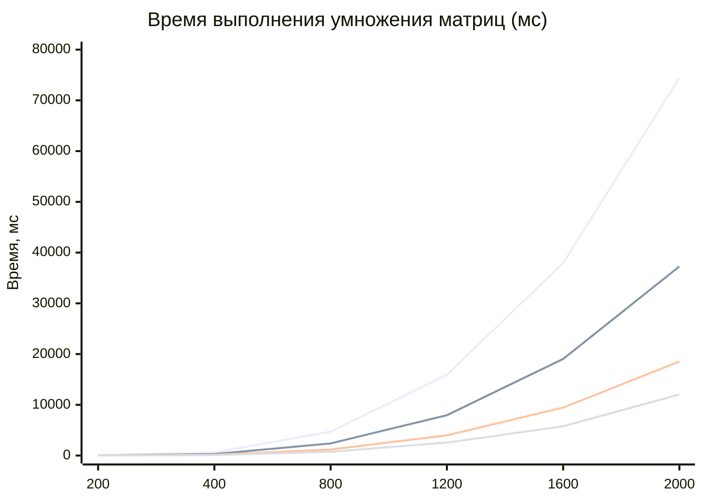

# Лабораторная работа №2: OpenMP

## Описание
Исследование эффективности распараллеливания операции умножения квадратных матриц $C = A \times B$ с использованием многопоточности OpenMP. Алгоритм использует директиву `#pragma omp parallel for schedule(static)` для распределения вычислений строк результирующей матрицы между потоками.

## Экспериментальная установка
- **Язык:** C++23 (модули)
- **Параллелизм:** OpenMP
- **Размеры матриц ($N$):** 200, 400, 800, 1200, 1600, 2000
- **Количество потоков ($T$):** 1, 2, 4, 8

## Результаты измерений времени выполнения

| Размер ($N$) | $T=1$ (мс) | $T=2$ (мс) | $T=4$ (мс) | $T=8$ (мс) |
|:------------:|:----------:|:----------:|:----------:|:----------:|
| 200          | 83.48      | 37.51      | 20.36      | 12.20      |
| 400          | 593.31     | 295.01     | 153.80     | 98.17      |
| 800          | 4718.16    | 2387.10    | 1183.60    | 734.50     |
| 1200         | 15928.58   | 7958.66    | 3989.32    | 2559.08    |
| 1600         | 37946.39   | 19045.34   | 9451.59    | 5774.45    |
| 2000         | 74446.51   | 37276.25   | 18536.01   | 12038.96   |

## Графики

### Зависимость времени выполнения от размера матрицы и количества потоков

Рис. 1. Экспериментальная зависимость времени выполнения от размера матрицы и количества потоков

## Выводы
1. **Масштабируемость:** Наблюдается практически линейное снижение времени выполнения при увеличении числа потоков с 1 до 8 для всех тестовых размеров матриц.
2. **Эффективность:** Отношение $T_{single} / T_{multi}$ близко к ожидаемому коэффициенту ускорения $p$, что свидетельствует о минимальных накладных расходах на синхронизацию и хорошем распределении нагрузки.
3. **Сложность:** Время выполнения растет пропорционально $O(N^3)$, как и ожидалось для классического алгоритма умножения матриц, но параллельная версия позволяет значительно сократить общее время вычислений за счет использования многоядерных архитектур.
